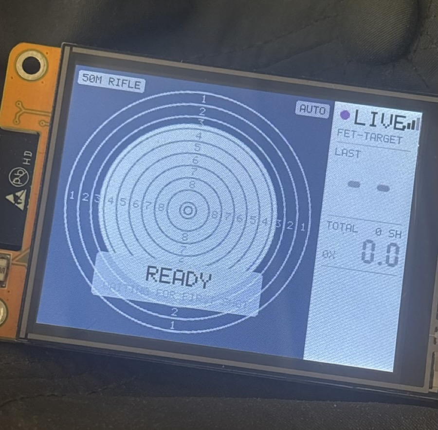
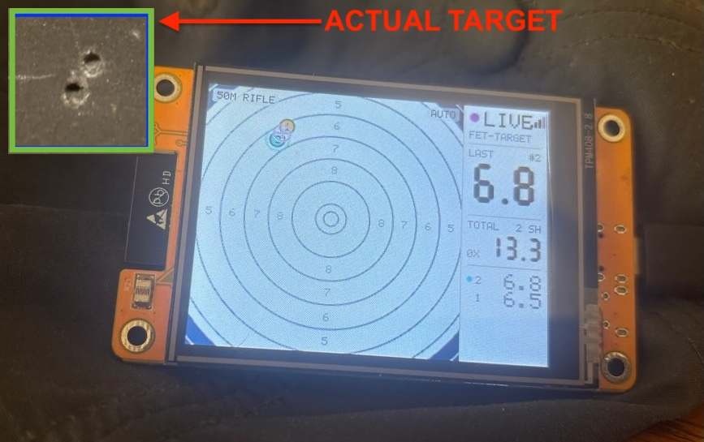

# freetarget-display

Live shot display for freETarget electronic targets on the ESP32 Cheap Yellow
Display (CYD).

A small standalone screen for [freETarget](https://github.com/ten-point-nine/freETarget)
electronic targets. It runs on the ESP32-2432S028R ("Cheap Yellow Display", CYD),
joins the target's WiFi by itself and shows every shot on the 2.8" screen as it
is fired, scored the same way as the freETarget PC app.

Built for smallbore (ISSF 50 m rifle by default), with 10 m air rifle and
10 m air pistol faces. Part of a project to create mobile smallbore target kits
that can be transported easily between ranges. 

**Author:** Compliments of [10point9.com](https://www.10point9.com)

## What it does

1. **Finds the target.** On power-up it scans for the strongest WiFi network
   whose name starts with `FET-` (the target's own network, `FET-TARGET` by
   default; open, no password) and joins it.
2. **Connects** to the target over TCP port 1090. This is the same link the
   freETarget PC app uses. The target is found at the WiFi gateway address
   (normally `192.168.10.9`).
3. **Reads shots** from the target's `{"shot":N, ... "x":mm, "y":mm, ...}`
   messages. Depending on its session setting, the target may also replay the
   shots it already holds when a client connects; those fill in at once.
4. **Scores and draws** each shot. If WiFi or the link drops, it reconnects
   by itself.
5. **Logs to microSD** if a card is in the slot (optional). Use a 32GB card.

At the moment, its a read only interface. 

## The screen

Connected and waiting for the first shot:



After two shots, with a photo of the paper target (top left) for comparison:



The target fills the left 240 × 240 pixels; the info panel is the right 80
pixels.

- **Target (left):** the newest shot is red with a halo, the 10 before it are
  blue, older ones grey-blue. From two shots on, a green cross and circle show
  the group centre and mean radius. Misses are not drawn. See **Zoom** below.
- **Panel (right):** link status and signal strength, network name, last score
  (gold for an inner ten), running total with inner-ten count, and the last
  5 shots.
- **Status messages** while starting up: SEARCHING, JOINING, CONNECTING,
  then READY.

## Zoom

The corner label shows the mode; tap BOOT to switch.

- **AUTO** (default): zooms in on the shots.
  - Before the first shot it shows the whole face.
  - After each shot it zooms so every shot so far fits, with a 15% margin.
  - It never zooms closer than ring 7 at the screen edge (about 2.9× on the
    50 m face), so a tight group still shows the rings around it.
  - The view stays centred on the bull; it does not follow the group.
  - It only zooms out during a session: one wide shot widens the view until
    the shots are cleared, so every shot stays on screen.
- **FULL:** always shows the whole face.

In both modes, a shot far off the face (more than 1.6× the face radius)
falls off the edge rather than shrinking the target to a dot.

## BOOT button

| Press | Action |
|---|---|
| Tap | AUTO / FULL zoom |
| Hold 1 s, release | Next target face (shown across the screen; saved) |
| Hold 4 s | Clear the screen (the target keeps its shots) |

## Target faces

| Face | Scoring | Pellet / bullet |
|---|---|---|
| ISSF 50 m rifle (default) | decimal, inner ten | .22 (5.6 mm) |
| ISSF 10 m air rifle | decimal, inner ten | 4.5 mm |
| ISSF 10 m air pistol | whole rings, inner ten | 4.5 mm |
| NSRA 25 yard | whole rings + X | .22 (5.6 mm) |

The BOOT button steps through 50 m rifle, air rifle and air pistol
(`FET_FACE_MENU` in `main/config.h`). The choice is saved and survives power
cycles. Until a face is picked, the CYD follows the `target_name` the target
sends (set by the PC app), else uses the default. NSRA 25 yd is used when the
target names it.

Ring sizes and scoring rules come from the PC app's target definitions
(`Software/C#/freETarget/targets/*.cs`). More faces can be added to `TARGETS[]`
in `main/targets.c`.

## Accuracy: matches the freETarget PC app

Shot placement and scoring follow the PC app's code:

- **Position:** `x`/`y` from the target are mm from the centre, +x right,
  +y up. They are scaled by `100 / "Distance to target (%)"`
  (`getScaledDimension`), then the calibration offset and rotation are applied
  the way `Shot.getX()/getY()` do it.
- **Score:** `11 − r / R10`, where R10 = ten-ring radius + bullet radius.
  Truncated to one decimal, capped at 10.9, 0 below 1.0 (`aTarget.getScore`,
  `Shot.computeScore`). Whole-ring faces take the integer part. NSRA uses the
  app's ring table. The radius goes through the same float to 7-digit decimal
  step, so shots exactly on a ring line score the same as on the PC.
- **Inner ten:** each face's `getInnerTenRadius()`.
- **Misses** score 0 and are not drawn. **Group centre:** from 2 shots on, as
  in `drawMeanGroup`.

Two PC-app quirks are copied on purpose so scores agree with the PC:
- **Calibration math:** when an offset and a rotation are both set, the drawn
  point and the scored radius don't quite agree.
- **NSRA inner ten:** counts when the shot centre is within 1.0 mm of the
  middle, with no allowance for bullet size.

The display shows what the target measures. Whether that matches the hole in
the card depends on the target's sensors and calibration.

**Match `main/config.h` to the PC app.** Distance %, calibration offsets,
bullet size and decimal scoring are PC-app settings that the target doesn't
send, so the CYD can't read them. Copy them into `config.h`, or the CYD and the
PC will disagree. (TODO: Make this select-able from the display board)

## microSD shot log

Optional.

- **Card:** FAT32. Cards of 32 GB or less come formatted FAT32 and work as
  they are. Larger cards usually come as exFAT, which isn't supported; the
  screen shows `SD: FORMAT FAT32`.
- **Files:** `/FET/FET0001.CSV`, `FET0002.CSV`, … one per session. A new file
  starts when the target's shot numbering restarts.
- **Columns:**
  `shot,uptime_s,face,x_mm,y_mm,plot_x_mm,plot_y_mm,radius_mm,score,inner,miss`.
  `x_mm`/`y_mm` are exactly what the target sent; `plot_*` and `radius_mm`
  are after the PC-app scaling and calibration. The board has no clock, so
  `uptime_s` is seconds since power-on (blank for shots written after the fact).
  (TODO: can we read timing data from the PC and save that to SD?)
- **De-duplicates:** if the target replays its stored shots after a reconnect
  or reboot, shots already in the file are recognized and skipped.
- **Insert any time:** a card is picked up within about 5 seconds, and the
  shots already on screen are written to it. Each shot is flushed to the card
  as it arrives in case power is lost.
- **On screen:** `SD FET0003.CSV` in green while logging, `SD ERROR` in red
  if the card fails or is pulled out.
- **Wiring** (CYD microSD slot, its own SPI bus): CLK 18, MOSI 23, MISO 19,
  CS 5. Internal pull-ups are enabled on the data lines, and the clock steps
  down from 20 MHz if a card can't keep up.

## Serial log

At 115200 baud the board prints each shot and its score, for checking against
the PC app:

```
I (519130) net: shot 1: hit x=-16.99 y=31.48
score 1: 50M RIFLE r=35.77 mm 6.5
```

## Settings

Everything is in `main/config.h`:

- `FET_SSID` / `FET_PASSWORD`: a fixed network name. You need to set this if
  working with multiple targets. Password (if `WIFI_PWD` is set on the target).
- `FET_HOST`: the target's IP, if it joins a club router instead of running
  its own network.
- `FET_DEFAULT_TARGET`, `FET_FACE_MENU`: default face and the BOOT-button list.
- `FET_DISTANCE_PERCENT`, `FET_CAL_X_MM`, `FET_CAL_Y_MM`, `FET_CAL_ANGLE_DEG`,
  `FET_CALIBER_MM`, `FET_DECIMAL`: copy these from the PC app.

## Hardware (Current)

ESP32-2432S028R (single USB port version) with an ILI9341 320×240 panel.

Looking for other devices to support, the goal is to keep the display
device well under $50. Above $50 and we should start considering low
cost Android tablets.


| Part | Pins |
|---|---|
| Display (SPI2) | SCLK 14, MOSI 13, MISO 12, CS 15, DC 2, backlight 21 |
| microSD (SPI3) | CLK 18, MOSI 23, MISO 19, CS 5 |
| BOOT button | GPIO 0 |

The panel uses the "ILI9341_2" start-up sequence that the CYD community
reference configuration selects. The classic ILI9341 sequence leaves this
panel washed-out grey.

## Build and flash

I used [PlatformIO](https://platformio.org/) (ESP-IDF framework, platform
`espressif32`).

    pio run -e cyd                                    # build
    pio run -e cyd -t upload --upload-port <port>     # flash
    pio device monitor                                # serial log

`<port>` is the board's USB serial port, for example `/dev/ttyUSB0` on Linux,
`/dev/cu.usbserial-XXXX` on macOS or `COM3` on Windows.

## Code layout

    main/app_main.c   start-up, screen refresh, BOOT button, saved face choice
    main/net.c        WiFi scan/join + TCP link to the target      (ESP-IDF)
    main/parse.c      shot message parser                          (plain C)
    main/model.c      shot list, PC-app placement and scoring      (plain C)
    main/targets.c    target faces and scoring rules               (plain C)
    main/ui.c         all drawing, anti-aliased, into RGB565 strips (plain C)
    main/lcd.c        ILI9341 display driver                       (ESP-IDF)
    main/sd.c         microSD shot log                             (ESP-IDF)
    main/config.h     settings

## Status

Tested on hardware: display, automatic WiFi connection, live shots and
scoring (50 m rifle). Built but not yet tested on hardware: face selection
and the microSD log.

Not implemented: touch screen (the CYD's touch panel is unused), and
changing target settings from the CYD. The target does accept settings
commands over this same WiFi link, so that is possible later.

## Credits

- [freETarget](https://github.com/ten-point-nine/freETarget) by ten-point-nine:
  the target, its shot protocol, and the PC app whose placement and scoring
  rules this display follows.
- Display start-up sequence from Bodmer's
  [TFT_eSPI](https://github.com/Bodmer/TFT_eSPI) (`ILI9341_2_DRIVER`), as chosen
  by the [ESP32 Cheap Yellow Display](https://github.com/witnessmenow/ESP32-Cheap-Yellow-Display)
  community reference.

## License

MIT. Copyright (c) 2026 Ejovi Nuwere and 10point9.com. See [LICENSE](LICENSE).
